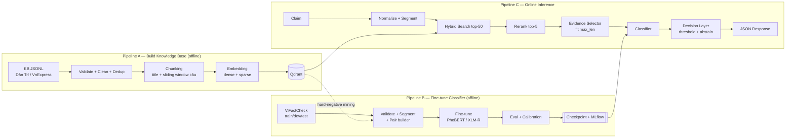

# ARCHITECTURE.md — Vietnamese Fake News Detection System

> **Vai trò tài liệu:** nguồn sự thật (single source of truth) về kiến trúc. Mọi Agent/Coder PHẢI đọc file này trước khi viết code.
> Nếu code cần đi chệch khỏi tài liệu này → cập nhật tài liệu trong cùng PR và ghi lại ở mục [9. Decision Log](#9-decision-log).

---

## 1. Mục tiêu & phạm vi

| Hạng mục | Nội dung |
|---|---|
| Bài toán | Cho một **claim** (câu tiếng Việt), trả về verdict `REAL` / `FAKE` / `UNVERIFIABLE` kèm **bằng chứng truy xuất được** và độ tin cậy. |
| Ngôn ngữ | Thuần tiếng Việt (không dịch, không đa ngữ ở giai đoạn này). |
| Kiến trúc lõi | **Retrieval (RAG)** tra cứu minh chứng từ Knowledge Base + **Classifier fine-tuned** (PhoBERT / XLM-R) đọc cặp `(Statement, Evidence)`. |
| Ngoài phạm vi (v1) | Phát hiện tin giả ảnh/video, phân tích mạng xã hội, đa ngôn ngữ, crawl realtime. |

## 2. Nguyên tắc thiết kế

1. **Tách offline / online.** Index và model là *artifact* được build offline, service online chỉ nạp và dùng.
2. **Config-driven.** Không hard-code đường dẫn, tên model, siêu tham số, ngưỡng; tất cả nằm trong `configs/*.yaml`.
3. **Mỗi tầng một trách nhiệm.** `data → retrieval → models → pipeline → serving`; tầng dưới không import tầng trên.
4. **Reproducible.** Seed cố định, version hóa data/model/index, log mọi run vào MLflow.
5. **Trung thực về độ không chắc chắn.** KB chỉ chứa tin `real` ⇒ *không tìm thấy bằng chứng ≠ tin giả*. Hệ thống phải biết nói `UNVERIFIABLE`.

## 3. Kiến trúc tổng thể



### 3.1 Artifact handoff (hợp đồng giữa offline và online)

| Artifact | Sinh ra bởi | Dùng bởi | Vị trí | Versioning |
|---|---|---|---|---|
| Qdrant collection `kb_chunks_<index_version>` | Pipeline A | Pipeline C (retrieval), Pipeline B (hard-negative) | Qdrant server / `artifacts/qdrant/` | `index_version` = hash(config + corpus) |
| Classifier checkpoint | Pipeline B | Pipeline C | `artifacts/models/<run_id>/` | MLflow run id |
| `decision_thresholds.json` | Pipeline B (tune trên dev) | Pipeline C | cạnh checkpoint | cùng run id |

## 4. Data contracts

### 4.1 KB record (đầu vào Pipeline A)
```json
{"id": "str", "title": "str", "text": "str", "label": "real", "url": "str", "date": "str"}
```
- `date` hiện là **ngày crawl**, KHÔNG phải ngày đăng bài ⇒ lưu thành `crawl_date`, **không dùng để lọc theo thời gian**.
- Chỉ dùng `title` + `text` để chunking/embedding.

### 4.2 Chunk (lưu trong Qdrant)
```json
{
  "chunk_id": "uuid5(doc_id + chunk_idx)",
  "doc_id": "str", "chunk_idx": 0,
  "title": "str", "text": "str", "text_segmented": "str",
  "url": "str", "crawl_date": "str", "source": "dantri|vnexpress"
}
```
- Vector: `dense` (bge-m3, 1024-d) + `sparse` (lexical weights). Payload như trên.
- ID xác định (deterministic) ⇒ upsert idempotent.

### 4.3 ViFactCheck sample (đầu vào Pipeline B)
```json
{"Statement": "str", "Context": "str", "labels": 0, "Evidence": "str"}
```
- **Model input = `(Statement, Evidence)`**. `Context` KHÔNG đưa vào model (không tồn tại lúc inference, nguy cơ leakage); chỉ dùng cho phân tích lỗi.
- Ánh xạ nhãn `0/1 → real/fake` **phải đọc từ `configs/base.yaml: label_map`** và được assert ở Phase 0 bằng cách kiểm tra mẫu thực tế. Không giả định.

### 4.4 API contract
`POST /v1/verify`
```json
// request
{"claim": "string (<= 512 chars)", "top_k": 5, "explain": false}

// response
{
  "verdict": "REAL | FAKE | UNVERIFIABLE",
  "confidence": 0.87,
  "evidences": [
    {"chunk_id": "...", "doc_id": "...", "title": "...", "url": "...",
     "snippet": "...", "retrieval_score": 0.71, "rerank_score": 0.93}
  ],
  "explanation": null,
  "model_version": "run_id", "index_version": "str", "latency_ms": 412
}
```
Các endpoint khác: `GET /healthz`, `GET /v1/version`.

## 5. Pipeline chi tiết

### 5.1 Pipeline A — Build Knowledge Base
1. **Validate** từng dòng JSONL bằng Pydantic; dòng lỗi ghi vào `data/interim/rejected.jsonl` (không crash).
2. **Clean:** Unicode NFC, bỏ khoảng trắng/ký tự điều khiển, bỏ boilerplate (dòng ảnh, "Xem thêm", nguồn…), loại bài `len(text) < min_chars`.
3. **Dedup:** theo `url` (exact) và MinHash trên `text` (near-duplicate).
4. **Chunking:** tách câu → cửa sổ trượt `3–5 câu`, overlap `1 câu`, mục tiêu `~120–160` token sau tách từ. Văn bản embedding = `title + "\n" + chunk`.
5. **Embedding:** dense + sparse, batch, chạy GPU nếu có.
6. **Upsert** vào Qdrant với payload (mục 4.2). Ghi `index_manifest.json` (số chunk, config hash, thời gian).

### 5.2 Pipeline B — Fine-tune Classifier
1. **Load** 3 split; assert nhãn ∈ {0,1}; kiểm tra phân bố nhãn.
2. **Tiền xử lý theo model:**
   - PhoBERT: **bắt buộc** tách từ (VnCoreNLP/underthesea) cả `Statement` và `Evidence`, **không lowercase**, `max_len = 256`.
   - XLM-R: không tách từ, `max_len = 512`.
3. **Pair builder** (3 chế độ, chọn bằng config):
   - `gold`: dùng `Evidence` gốc của ViFactCheck (baseline).
   - `retrieved`: thay/trộn evidence bằng top-k từ Qdrant để thu hẹp **train–serve skew**.
   - `mixed`: xác suất `p_gold` / `1-p_gold` (khuyến nghị cho bản cuối).
4. **Train:** HF `Trainer`, AdamW, warmup + linear decay, early stopping theo **macro-F1 trên dev**, mixed precision.
5. **Hiệu chỉnh (calibration):** temperature scaling trên dev ⇒ xác suất đáng tin để đặt ngưỡng abstain.
6. **Đánh giá:** accuracy, macro-F1, per-class P/R/F1, ECE, confusion matrix. **Test chỉ chạy 1 lần cho mỗi cấu hình đã chốt.**

### 5.3 Pipeline C — Online Inference
| Bước | Mô tả | Tham số (trong config) |
|---|---|---|
| Normalize | NFC, trim, tách từ nếu model cần | — |
| Hybrid search | dense + sparse, hợp nhất bằng RRF | `retrieve_k=50` |
| Rerank | cross-encoder chấm lại | `rerank_k=5` |
| Evidence selector | chọn câu liên quan nhất từ top chunk, ghép vừa `max_len - len(statement)` | `max_evidence_tokens` |
| Classifier | softmax đã calibrate | — |
| Decision | `UNVERIFIABLE` nếu `top_rerank_score < τ_retrieval` **hoặc** `max_prob < τ_conf`; ngược lại theo nhãn | `τ_retrieval`, `τ_conf` (tune trên dev) |
| (Tùy chọn) Explain | LLM sinh lời giải thích *từ evidence đã chọn*, không được thêm sự kiện mới | `explain=true` |

## 6. Tech stack

| Lớp | Lựa chọn mặc định | Phương án thay thế / ghi chú |
|---|---|---|
| Ngôn ngữ / quản lý gói | Python 3.11, `uv` | Poetry |
| Tách từ tiếng Việt | `py_vncorenlp` (VnCoreNLP, cần Java) | `underthesea` (cài dễ hơn, chậm hơn) |
| Model phân loại | `vinai/phobert-base-v2` | `xlm-roberta-base/large`, `vinai/phobert-large` |
| Embedding | `BAAI/bge-m3` (dense + sparse, 8k ctx) | `AITeamVN/Vietnamese_Embedding`, `intfloat/multilingual-e5-large`, `bkai-foundation-models/vietnamese-bi-encoder` — **benchmark ở Phase 2** |
| Reranker | `BAAI/bge-reranker-v2-m3` | `AITeamVN/Vietnamese_Reranker` — benchmark ở Phase 2 |
| Vector DB | **Qdrant** (hybrid dense+sparse, payload filter, chạy Docker/local) | FAISS (chỉ cho test/prototype), pgvector |
| ML framework | PyTorch, HF `transformers`/`datasets`/`accelerate`, `sentence-transformers`/`FlagEmbedding` | — |
| Experiment tracking | MLflow | Weights & Biases |
| Data versioning | DVC | Git LFS |
| Config | YAML + `pydantic-settings` | Hydra |
| API | FastAPI + Uvicorn, Pydantic v2 | — |
| Demo UI | Streamlit hoặc Gradio | — |
| Chất lượng code | `ruff`, `mypy`, `pytest`, `pre-commit` | — |
| Đóng gói | Docker, `docker-compose` (api + qdrant + mlflow) | — |
| CI | GitHub Actions (lint + unit test) | — |

> Tên model trên Hugging Face cần được xác minh lại (tồn tại, license, kích thước) ở Phase 0 trước khi khóa vào config.

## 7. Chiến lược đánh giá

| Tầng | Chỉ số | Ghi chú |
|---|---|---|
| Retrieval | Recall@k, MRR, nDCG@k | Gold evidence của ViFactCheck **có thể không nằm trong KB** ⇒ Phase 0 phải đo mức trùng lặp; nếu thấp, dùng proxy (khớp n-gram/entity) hoặc tự gán nhãn một tập nhỏ. |
| Classifier (gold evidence) | Accuracy, macro-F1, ECE | Trần hiệu năng khi evidence hoàn hảo. |
| End-to-end (retrieved evidence) | macro-F1 trên các mẫu *được trả lời*, **coverage** (tỉ lệ không abstain) | Vẽ đường cong coverage–F1 để chọn ngưỡng. |
| Ablation | gold vs retrieved vs mixed; PhoBERT vs XLM-R; có/không rerank | Mỗi ablation 1 run MLflow. |
| Error analysis | Phân loại lỗi: retrieval miss / evidence nhiễu / model sai | Notebook trong `notebooks/`. |

## 8. Rủi ro & giả định đã biết

| # | Rủi ro / giả định | Giảm thiểu |
|---|---|---|
| R1 | **Train–serve skew:** train bằng gold evidence, serve bằng evidence truy xuất (nhiễu). | Chế độ `mixed`/`retrieved` ở 5.2; đo E2E riêng. |
| R2 | **KB chỉ có tin `real`:** không có bằng chứng ≠ giả. | Nhãn `UNVERIFIABLE`; `FAKE` chỉ khi evidence mâu thuẫn rõ. |
| R3 | **PhoBERT giới hạn 256 token:** evidence dài bị cắt. | Evidence selector cấp câu; XLM-R (512) làm phương án so sánh. |
| R4 | `date` là ngày crawl. | Không lọc thời gian; nếu cần, crawl lại với `published_date` (backlog). |
| R5 | Nhãn 0/1 chưa rõ ngữ nghĩa. | `label_map` trong config + assert ở Phase 0. |
| R6 | Tin giả có thể được tạo từ sự kiện thật bị bóp méo ⇒ retrieval trả bài đúng chủ đề nhưng khác chi tiết. | Reranker + classifier học trên cặp có chi tiết sai lệch (ViFactCheck); xem xét NEI augmentation. |
| R7 | Rò rỉ test vào train/dev. | Dedup chéo split bằng hash `Statement`; test bị khóa đến khi chốt cấu hình. |

## 9. Decision Log

| Ngày | Quyết định | Lý do | Người duyệt |
|---|---|---|---|
| _(điền khi phát sinh)_ | | | |

## 10. Câu hỏi mở (cần chốt ở Phase 0)

- [ ] Gold `Evidence` của ViFactCheck có xuất hiện trong KB Dân Trí/VnExpress không (tỉ lệ)?
- [ ] Ngữ nghĩa nhãn `0/1` và phân bố nhãn từng split?
- [ ] Kích thước KB (số bài, số chunk) ⇒ chọn Qdrant local hay server?
- [ ] Có GPU không (loại, VRAM) ⇒ chọn `base` hay `large`?
- [ ] Có cần `UNVERIFIABLE` như nhãn huấn luyện (3-class, NEI augmentation) hay chỉ là luật ngưỡng?
