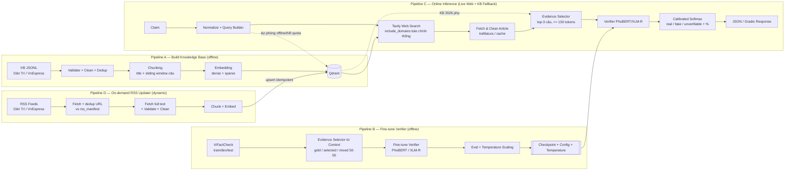

# ARCHITECTURE.md — Vietnamese Fake News Detection System

> **Vai trò tài liệu:** nguồn sự thật (single source of truth) về kiến trúc. Mọi Agent/Coder PHẢI đọc file này trước khi viết code.
> Nếu code cần đi chệch khỏi tài liệu này → cập nhật tài liệu trong cùng PR và ghi lại ở mục [9. Decision Log](#9-decision-log).

---

## 1. Mục tiêu & phạm vi

| Hạng mục           | Nội dung                                                                                                                                |
| ------------------ | --------------------------------------------------------------------------------------------------------------------------------------- |
| Bài toán           | Cho một **claim** (câu tiếng Việt), trả về đầu ra **3 lớp** (`real` = chắc chắn thật, `fake` = chắc chắn giả, `unverifiable` = chưa xác định; khớp `label_map`: `0=real, 1=fake, 2=unverifiable`) kèm **xác suất (%)** đã hiệu chỉnh của mô hình và **bằng chứng truy xuất được**. |
| Nguồn bằng chứng   | **Hướng thời sự (PM chốt 2026-11-09):** Nguồn bằng chứng chính = **tìm kiếm web giới hạn trong báo chính thống** (Tavily Web Search + trích xuất văn bản); kho **KB 2026 (Qdrant)** là nguồn phụ / dự phòng khi mất mạng hoặc hết quota. |
| Vai trò ViFactCheck | Dùng để **huấn luyện và đánh giá bộ đọc (verifier)** (cả `gold Evidence` và câu chọn từ `Context`). Không dùng để đo retrieval trên KB 2026 (nhãn người C1 xác nhận chỉ 4/451 trùng khớp do lệch thời gian). |
| Ngôn ngữ           | Thuần tiếng Việt (không dịch, không đa ngữ ở giai đoạn này).                                                                            |
| Kiến trúc lõi      | **Web Search / KB Retrieval** + **Evidence Selector** (`bge-reranker-v2-m3` / BM25) + **Verifier fine-tuned** (`vinai/phobert-base-v2`, `xlm-roberta-base`) đọc cặp `(Statement, evidence_text)` + **Temperature Scaling**. |
| Ngoài phạm vi (v1) | Phát hiện tin giả ảnh/video, phân tích mạng xã hội, đa ngôn ngữ, crawl realtime liên tục. Các hạng mục Phase 2.5 nâng cao (C2, nạp RSS vào collection chính, ONNX, dynamic chunk, alpha, hard-negative từ Qdrant) được **đóng băng** từ 2026-11-09. |

## 2. Nguyên tắc thiết kế

1. **Tách offline / online.** Index và model là _artifact_ được build offline, service online chỉ nạp và dùng.
2. **Config-driven.** Không hard-code đường dẫn, tên model, siêu tham số, ngưỡng; tất cả nằm trong `configs/*.yaml`.
3. **Mỗi tầng một trách nhiệm.** `data → retrieval → models → pipeline → serving`; tầng dưới không import tầng trên.
4. **Reproducible.** Seed cố định, version hóa data/model/index, log mọi run vào MLflow.
5. **Trung thực về độ không chắc chắn.** KB chỉ chứa tin `real` ⇒ _không tìm thấy bằng chứng ≠ tin giả_. Hệ thống phải biết nói `UNVERIFIABLE`.

## 3. Kiến trúc tổng thể



### 3.1 Artifact handoff (hợp đồng giữa offline và online)

| Artifact                                      | Sinh ra bởi                | Dùng bởi                                           | Vị trí                              | Versioning                              |
| --------------------------------------------- | -------------------------- | -------------------------------------------------- | ----------------------------------- | --------------------------------------- |
| Qdrant collection `kb_chunks_<index_version>` | Pipeline A                 | Pipeline C (retrieval), Pipeline B (hard-negative) | Qdrant server / `artifacts/qdrant/` | `index_version` = hash(config + corpus) |
| Classifier checkpoint                         | Pipeline B                 | Pipeline C                                         | `artifacts/models/<run_id>/`        | MLflow run id                           |
| `decision_thresholds.json`                    | Pipeline B (tune trên dev) | Pipeline C                                         | cạnh checkpoint                     | cùng run id                             |
| `rss_manifest.json` | Pipeline D | Pipeline D (dedup URL, ETag/Last-Modified) | `artifacts/rss/` | cập nhật mỗi lần chạy |
| Query-rewrite cache | Pipeline C / script eval | Pipeline C, `evaluation/` | `artifacts/cache/query_rewrite/` | key = hash(claim NFC + `prompt_version` + model) |

> **Ngữ nghĩa `index_version` khi có RSS:** `index_version` chỉ định danh **snapshot nền (static)**. Lớp dữ liệu động (Pipeline D) upsert vào **cùng collection** và được theo dõi bằng `dynamic_chunks` + `rss_last_updated` trong `index_manifest.json`, để không phải đổi tên collection sau mỗi lần cập nhật RSS (xem Decision Log 2026-11-08).

## 4. Data contracts

### 4.1 KB record (đầu vào Pipeline A)

```json
{
  "id": "str",
  "title": "str",
  "text": "str",
  "label": "real",
  "url": "str",
  "date": "str"
}
```

- `date` hiện là **ngày crawl**, KHÔNG phải ngày đăng bài ⇒ lưu thành `crawl_date`, **không dùng để lọc theo thời gian**.
- Chỉ dùng `title` + `text` để chunking/embedding.

**Hợp đồng trường thời gian (PM chốt 2026-11-08):**

| Nguồn | Trường gốc | Trường trong hệ thống | Ghi chú |
|---|---|---|---|
| KB tĩnh `.jsonl` | `date` (thực chất là **ngày cào**, không phải ngày đăng) | `crawl_date` | Đổi tên ở tầng schema/loader (alias `date` → `crawl_date`); file raw do DVC quản lý nên không sửa tại chỗ, mọi output trong `data/processed/` ghi `crawl_date`. Định dạng chưa chuẩn hóa — chỉ để tham khảo |
| RSS | `pubDate` (XML) | `published_date` | ISO-8601 UTC |
| RSS | thời điểm fetch | `crawl_date` | ISO-8601 UTC |

Hệ quả được chấp nhận: dữ liệu tĩnh **không có** ngày đăng ⇒ hệ thống **không thể lọc theo thời gian trên toàn KB**; `published_date = null` với dữ liệu tĩnh. Task "lọc theo thời gian" nằm ở Backlog. Code **không được** dùng `crawl_date` như ngày đăng bài.

### 4.1b KB record từ RSS (đầu vào Pipeline D — luồng động)

```json
{
  "id": "str (guid hoặc hash(url))",
  "title": "str",
  "text": "str (full text đã trích từ trang bài viết)",
  "label": "real",
  "url": "str",
  "crawl_date": "ISO-8601 (thời điểm fetch)",
  "published_date": "ISO-8601 UTC (từ pubDate của RSS)",
  "ingest_source": "rss"
}
```

- RSS thường chỉ cung cấp tiêu đề + mô tả ngắn ⇒ **phải fetch trang bài viết** để có `text` (xác minh ở audit RSS, `docs/DATA_AUDIT.md` §2b).
- `published_date` là trường thời gian đáng tin **duy nhất** của hệ thống, nhưng chỉ có ở dữ liệu động ⇒ vẫn **chưa** lọc thời gian trên toàn KB.
- `label="real"` vì cùng nguồn báo chính thống; dữ liệu RSS **không** dùng để huấn luyện hay chấm proxy trên dev.

### 4.2 Chunk (lưu trong Qdrant)

```json
{
  "chunk_id": "uuid5(doc_id + chunk_idx)",
  "doc_id": "str",
  "chunk_idx": 0,
  "title": "str",
  "text": "str",
  "text_segmented": "str",
  "url": "str",
  "crawl_date": "str",
  "source": "dantri|vnexpress",
  "published_date": "str|null",
  "ingest_source": "static|rss"
}
```

- Vector: `dense` (bge-m3, 1024-d) + `sparse` (lexical weights). Payload như trên.
- ID xác định (deterministic) ⇒ upsert idempotent (áp dụng cả cho chunk từ RSS).
- `published_date` = `null` với dữ liệu tĩnh; `ingest_source` phân biệt lớp tĩnh/động.

### 4.3 ViFactCheck sample (đầu vào Pipeline B)

```json
{ "Statement": "str", "Context": "str", "labels": 0, "Evidence": "str" }
```

**Model input = `(Statement, evidence_text)`**. **`Context` KHÔNG đưa nguyên vào model**; `Context` chỉ được dùng làm "bài báo giả lập" để chọn câu bằng chứng (`retrieval/evidence_selector.py`, xem §5.2).
**Nhãn: 3 lớp — `0=real`, `1=fake`, `2=unverifiable`** (chốt ở Phase 0, xem `docs/DATA_AUDIT.md` §3–§4). Ánh xạ lấy từ `configs/base.yaml: label_map`, assert ở Phase 0 bằng mẫu thực tế. Không giả định.
Classifier là **3-class**, không phải 2-class.

### 4.4 API contract

`POST /v1/verify`

```json
// request
{"claim": "string (<= 512 chars)", "top_k": 5, "explain": false}

// response
{
  "verdict": "REAL | FAKE | UNVERIFIABLE",
  "confidence": 0.87,
  "evidences": [
    {"chunk_id": "...", "doc_id": "...", "title": "...", "url": "...",
     "snippet": "...", "retrieval_score": 0.71, "rerank_score": 0.93}
  ],
  "explanation": null,
  "model_version": "run_id", "index_version": "str", "latency_ms": 412
}
```

Các endpoint khác: `GET /healthz`, `GET /v1/version` (trả thêm `rss_last_updated`). Phase 5 bổ sung `POST /v1/admin/refresh-kb` (chỉ nội bộ, có API key) để kích hoạt Pipeline D.

## 5. Pipeline chi tiết

### 5.1 Pipeline A — Build Knowledge Base

1. **Validate** từng dòng JSONL bằng Pydantic; dòng lỗi ghi vào `data/interim/rejected.jsonl` (không crash).
2. **Clean:** Unicode NFC, bỏ khoảng trắng/ký tự điều khiển, bỏ boilerplate (dòng ảnh, "Xem thêm", nguồn…), loại bài `len(text) < min_chars`.
3. **Dedup:** theo `url` (exact) và MinHash trên `text` (near-duplicate).
4. **Chunking:** tách câu → cửa sổ trượt `3–5 câu`, overlap `1 câu`, mục tiêu `~120–160` token sau tách từ. Văn bản embedding = `title + "\n" + chunk`.
5. **Embedding:** dense + sparse, batch, chạy GPU nếu có.
6. **Upsert** vào Qdrant với payload (mục 4.2). Ghi `index_manifest.json` (số chunk, config hash, thời gian).

### 5.2 Pipeline B — Fine-tune Verifier (Phase 3, cập nhật Brief #4)

1. **Load** `train_clean.jsonl` và `dev_clean.jsonl`; assert nhãn ∈ `{0, 1, 2}` (`0=real, 1=fake, 2=unverifiable`). **Tuyệt đối không đọc `test`** cho tới khi có cờ `--final` do PM cho phép.
2. **Evidence Selector từ `Context` (`retrieval/evidence_selector.py` & `scripts/09_select_evidence.py`):**
   - Tách `Context` thành các câu; chấm điểm từng câu với `Statement` (BM25 trên tập lớn 5,000+ bài hoặc `bge-reranker-v2-m3`); chọn **top-3 câu, giữ thứ tự gốc trong bài**, tổng độ dài ≤ ~150 token; cache vào `data/interim/selected_{train,dev}.jsonl`.
   - Đo chất lượng chọn câu bằng tỉ lệ mẫu `dev` có 3-gram containment của gold `Evidence` trong câu chọn ≥ 0.5.
3. **Tiền xử lý & Tokenization (`models/tokenization.py`):**
   - PhoBERT (`vinai/phobert-base-v2`): **bắt buộc** tách từ cả `Statement` và `evidence_text`, **không lowercase**, `max_len = 256`, `truncation="only_second"`.
   - XLM-R (`xlm-roberta-base`): văn bản thô NFC, `max_len = 512`, `truncation="only_second"`.
4. **4 Biến thể huấn luyện và đánh giá:**
   - **V-A:** huấn luyện bằng gold `Evidence`; đánh giá trên `dev` với cả gold và selected.
   - **V-B:** huấn luyện bằng selected từ `Context`; đánh giá trên `dev` với cả selected và gold.
   - **V-C:** huấn luyện trộn 50/50 gold + selected; đánh giá trên cả hai.
   - **Baseline (bắt buộc):** chỉ `Statement` (không có bằng chứng) để đo mức độ đoán mò từ câu chữ của claim.
5. **Train (`training/train.py` & `scripts/10_train_verifier.py`):** AdamW, `lr=2e-5`, effective batch size 32 (`batch=8, grad_accum=4`), 4–5 epochs, warmup 10%, weight decay 0.01. Trên PC GTX 1660 chạy `fp32` (`fp16=false`); trên Colab T4 chạy `fp16`. Chọn checkpoint theo **macro-F1 trên dev**.
6. **Hiệu chỉnh xác suất (`models/calibration.py`):** Temperature scaling **chỉ fit trên dev**; báo ECE trước/sau. Đầu ra là softmax đã hiệu chỉnh (`real / fake / unverifiable` kèm xác suất % — biểu thị độ tin cậy của mô hình trên bằng chứng đã có).

### 5.3 Pipeline C — Online Inference (Live Web Search + KB Fallback)

| Bước               | Mô tả                                                                                                 | Tham số (trong config)                  |
| ------------------ | ----------------------------------------------------------------------------------------------------- | --------------------------------------- |
| Normalize & Query  | NFC, trim; xây dựng truy vấn Q0 (claim ≤ 400 ký tự) / Q1 (từ khóa theo luật) / Q2 (Gemini rewrite tùy chọn với `total_deadline_s`, online không retry timeout) | `configs/search.yaml`, `query_rewrite.*` |
| Web Search (chính) | Tìm kiếm web qua **Tavily API** giới hạn trong danh sách báo chính thống (`include_domains`), cache phản hồi thô vào đĩa, lấy văn bản bằng `trafilatura` / nội dung trả về | `provider=tavily`, `max_results=5`, `topic=general` |
| KB 2026 (phụ)      | Tra cứu Qdrant Hybrid Search + Rerank khi mất mạng, hết quota hoặc chế độ dự phòng demo               | `retrieve_k=30`, `rerank_k=5`           |
| Evidence selector  | Tách câu từ bài báo tìm được, chọn top-3 câu liên quan nhất giữ thứ tự gốc (≤ ~150 token)             | `max_evidence_tokens=150`               |
| Verifier + Calib   | PhoBERT / XLM-R đọc `(Statement, selected_evidence)` → Temperature Scaling → nhãn `real` / `fake` / `unverifiable` kèm **xác suất (%)** | `temperature` lưu cạnh checkpoint       |

### 5.3.1 LLM Query Rewrite (Phase 2.5)

**Mục đích:** claim đời thường/lóng/ngắn lệch miền ngôn ngữ so với văn phong báo chí trong KB ⇒ viết lại thành từ khóa gần với cách báo chí diễn đạt để tăng khớp từ vựng ở Hybrid Search.

| Hạng mục | Quy định |
| --- | --- |
| Vị trí | Sau Normalize, **ngay trước** Qdrant Hybrid Search |
| Model | **Gemini họ Flash** (Flash / Flash-Lite), free tier. **Model đã chốt: `gemini-3.1-flash-lite`** (PM, 2026-11-08), đặt ở `query_rewrite.model`; validator Pydantic chỉ chấp nhận họ Flash và **chặn `gemini-1.5-*`** (đã bị Google ngừng) |
| Input / Output | Claim đã NFC (không tách từ) → **một dòng** từ khóa tiếng Việt |
| Prompt | `configs/prompts/query_rewrite.txt`; bắt buộc có câu: *"Tuyệt đối CHỈ in ra từ khóa. KHÔNG chào hỏi, KHÔNG dạ vâng, KHÔNG giải thích."*; claim đặt trong delimiter, coi là dữ liệu |
| Hậu xử lý | `sanitize_keywords()` trước khi embed (bỏ markdown/tiền tố/lời thoại); không hợp lệ ⇒ fallback |
| Phạm vi dùng | **Chỉ** bước retrieve. Reranker và classifier luôn nhận claim gốc; response không trả chuỗi rewrite |
| Fail-safe | Timeout / 429 / 5xx / output rác ⇒ dùng claim gốc, log `rewrite_status=fallback:<reason>` |
| Cache | Đĩa, key = hash(claim NFC + `prompt_version` + model); script đánh giá phải đọc qua cache để không đốt quota free tier |
| `fusion` | `rewritten_only` (mặc định) \| `original+rewritten` (RRF hai truy vấn) — dùng cho A/B ở Phase 2.5 |

Ví dụ minh họa (không phải kết quả đo): `"mấy bữa nay đồn xăng sắp tăng giá mạnh thật hông"` → `giá xăng dầu tăng điều chỉnh giá`.

> Query rewrite chỉ cải thiện khớp từ vựng; **không tạo ra bằng chứng không có trong KB** (xem R10).

### 5.3.2 Ngân sách latency (baseline đo 2026-11-07, `docs/REPORT_retrieval.md`)

| Bước | Baseline (`retrieve_k=50`) | Ghi chú |
| --- | ---: | --- |
| Embedding (`bge-m3` dense + sparse) | 180.30 ms / câu | trung bình |
| Hybrid Search (Qdrant RRF) p50 / p95 | 28.25 / 43.07 ms | đạt exit criteria < 300 ms |
| Rerank (`bge-reranker-v2-m3`, 50 → 5) p50 / p95 | 14,652 / 19,533 ms | nút thắt chính |
| Query rewrite (Gemini) | chưa đo | đo ở Phase 2.5 |

**Quyết định:** `retrieve_k` 50 → **20**. Chi phí rerank tăng gần tuyến tính theo số cặp (claim, chunk) ⇒ ước lượng còn ≈ 40% baseline (p50 ≈ 5.9 s, p95 ≈ 7.8 s) — **đây là ước lượng, chưa đo**. Hai hệ quả phải ghi nhận:

- `retrieve_k=20` **một mình chưa đủ** cho demo tương tác; cần profiling và (nếu cần) ONNX/quantization (xem *Future Enhancements* trong `ROADMAP_TODO.md`).
- Hybrid Hit Rate@50 (proxy) hiện chỉ 10.51% là trần recall của rerank ở k=50; hạ xuống 20 chỉ có thể giữ hoặc giảm trần này ⇒ phải đo Hit Rate@20 trước khi chốt.

Mọi lần đo latency phải ghi kèm thiết bị (CPU/GPU), dtype, batch size, `max_length` và `retrieve_k`.

**Mục tiêu latency (PM chốt 2026-11-08):** rerank **p95 ≤ 10 s** cho Phase 2.5 (ước lượng ở k=20 ≈ 7.8 s, chưa đo). Ngưỡng **≤ 3 s** chuyển sang *Future Enhancements* (ONNX). **Guardrail:** không hạ `retrieve_k` dưới 20 để đạt ngưỡng nếu chưa có Decision Log + PM duyệt; nếu đo thực tế vẫn > 10 s, tối ưu tham số suy luận (dtype, batch size, `max_length`) trước.

### 5.4 Pipeline D — On-demand RSS Updater (dữ liệu động)

**Mục đích:** bổ sung tin mới vào KB mà không phải build lại toàn bộ Pipeline A. Đây là luồng **động**, bổ trợ cho KB tĩnh `.jsonl`.

1. **Kích hoạt on-demand:** CLI `scripts/05_update_rss.py` (có `--dry-run`) hoặc `POST /v1/admin/refresh-kb` (Phase 5). **Không** chạy nền tự động.
2. **Fetch feed** liệt kê trong `configs/rss.yaml` (13 feed: 8 VnExpress + 5 Dân Trí, PM chốt 2026-11-08; `tin-moi-nhat` của Dân Trí chồng lấn với các feed chuyên mục nên dedup URL là bắt buộc): conditional GET (ETag/Last-Modified), User-Agent định danh, rate limit, timeout, tôn trọng `robots.txt`.
3. **Dedup URL** với `rss_manifest.json` và với URL của KB tĩnh **trước** khi fetch trang.
4. **Lấy full text** (RSS thường chỉ có tiêu đề + mô tả), validate bằng Pydantic (§4.1b); lỗi ghi vào `rejected`.
5. **Tái dùng Pipeline A:** Clean → near-dup (MinHash) → Chunk → Embed.
6. **Upsert idempotent** vào cùng collection với `ingest_source="rss"` và `published_date`; cập nhật `index_manifest.json` (`dynamic_chunks`, `rss_last_updated`) và `rss_manifest.json`.
7. **Báo cáo:** số bài mới / bỏ qua (trùng) / lỗi.

Ràng buộc: RSS **không** vào tập huấn luyện/đánh giá. RSS cải thiện độ phủ cho **tin thời sự thực tế**, không kỳ vọng tăng Hit Rate trên dev ViFactCheck (nội dung cũ, gần như không có trong nguồn báo này — `docs/DATA_AUDIT.md` §6).

## 6. Tech stack

| Lớp                    | Lựa chọn mặc định                                                                           | Phương án thay thế / ghi chú                                                                                                                |
| ---------------------- | ------------------------------------------------------------------------------------------- | ------------------------------------------------------------------------------------------------------------------------------------------- |
| Ngôn ngữ / quản lý gói | Python 3.11, `uv`                                                                           | Poetry                                                                                                                                      |
| Tách từ tiếng Việt     | `py_vncorenlp` (VnCoreNLP, cần Java)                                                        | `underthesea` (cài dễ hơn, chậm hơn)                                                                                                        |
| Model phân loại        | `vinai/phobert-base-v2`                                                                     | `xlm-roberta-base/large`, `vinai/phobert-large`                                                                                             |
| Embedding              | `BAAI/bge-m3` (dense + sparse, 8k ctx)                                                      | `AITeamVN/Vietnamese_Embedding`, `intfloat/multilingual-e5-large`, `bkai-foundation-models/vietnamese-bi-encoder` — **benchmark ở Phase 2** |
| Reranker               | `BAAI/bge-reranker-v2-m3`                                                                   | `AITeamVN/Vietnamese_Reranker` — benchmark ở Phase 2                                                                                        |
| Vector DB              | **Qdrant** (hybrid dense+sparse, payload filter, chạy Docker/local)                         | FAISS (chỉ cho test/prototype), pgvector                                                                                                    |
| Query rewrite (LLM) | Gemini họ **Flash** (free tier) qua SDK `google-genai`; model chốt `gemini-3.1-flash-lite` (đặt trong config), validator chặn `gemini-1.5-*` | Model id Gemini đổi/ngừng nhanh — kiểm tra `models.list` trước khi khóa vào config |
| RSS ingestion | `feedparser` + `httpx` + `trafilatura` (đề xuất) | `selectolax`/BeautifulSoup với selector riêng từng báo; thêm vào `pyproject.toml` kèm lý do |
| ML framework           | PyTorch, HF `transformers`/`datasets`/`accelerate`, `sentence-transformers`/`FlagEmbedding` | —                                                                                                                                           |
| Experiment tracking    | MLflow                                                                                      | Weights & Biases                                                                                                                            |
| Data versioning        | DVC                                                                                         | Git LFS                                                                                                                                     |
| Config                 | YAML + `pydantic-settings`                                                                  | Hydra                                                                                                                                       |
| API                    | FastAPI + Uvicorn, Pydantic v2                                                              | —                                                                                                                                           |
| Demo UI                | Streamlit hoặc Gradio                                                                       | —                                                                                                                                           |
| Chất lượng code        | `ruff`, `mypy`, `pytest`, `pre-commit`                                                      | —                                                                                                                                           |
| Đóng gói               | Docker, `docker-compose` (api + qdrant + mlflow)                                            | —                                                                                                                                           |
| CI                     | GitHub Actions (lint + unit test)                                                           | —                                                                                                                                           |

> Tên model trên Hugging Face cần được xác minh lại (tồn tại, license, kích thước) ở Phase 0 trước khi khóa vào config.

## 7. Chiến lược đánh giá (Hai phần — Brief #4 §4.1)

| Phần / Tầng                     | Chỉ số                                                                   | Ghi chú                                                                                                                                                              |
| ------------------------------- | ------------------------------------------------------------------------ | -------------------------------------------------------------------------------------------------------------------------------------------------------------------- |
| **Phần 1: Bộ đọc (Verifier)**   | Accuracy, Macro-F1, P/R/F1 từng lớp (`real/fake/unverifiable`), ECE trước/sau calibration, Confusion Matrix | Đánh giá trên **ViFactCheck với bài báo đúng** (`gold Evidence` và câu `selected` từ `Context` bằng `evidence_selector.py`). Bắt buộc đối chiếu với **Baseline chỉ `Statement`** (không có bằng chứng). |
| **Phần 2: Bộ tìm (Web Search)** | Tỉ lệ claim (trên 30 claim dev) có ít nhất 1 trang trong top-5 đạt **3-gram containment ≥ 0.5** (và ≥ 0.3) so với gold `Evidence`; phân tích theo lớp nhãn; số credit đã dùng; độ trễ p50/p95 | Thử nghiệm tìm kiếm web qua **Tavily API** giới hạn trong 16 tên miền báo chính thống (`configs/search.yaml`), so sánh truy vấn Q0 (claim gốc ≤ 400 ký tự) và Q1 (từ khóa theo luật). Cổng quyết định của PM: ≥ 30% tiến hành, 15–30% thận trọng, < 15% Kế hoạch B. |
| **Đầu-cuối (End-to-End)**       | Macro-F1, độ phủ và phân tích lỗi (retrieval miss / evidence nhiễu / model sai) | Ghép bộ tìm + `evidence_selector` + `verifier` đã hiệu chỉnh xác suất; có chế độ dự phòng cache / KB 2026 cho demo trực tiếp ngày 24/11. |

## 8. Rủi ro & giả định đã biết

| #   | Rủi ro / giả định                                                                                       | Giảm thiểu                                                                                       |
| --- | ------------------------------------------------------------------------------------------------------- | ------------------------------------------------------------------------------------------------ |
| R1  | **Train–serve skew:** train bằng gold evidence, serve bằng câu bằng chứng trích xuất (nhiễu).           | Huấn luyện và đánh giá 3 biến thể V-A (gold), V-B (selected từ `Context`), V-C (trộn 50/50) ở §5.2. |
| R2  | **KB chỉ có tin `real`:** không có bằng chứng ≠ giả.                                                    | Nhãn `UNVERIFIABLE`; `FAKE` chỉ khi evidence mâu thuẫn rõ.                                       |
| R3  | **PhoBERT giới hạn 256 token:** evidence dài bị cắt.                                                    | Đo phân bố token thật trước khi train; `evidence_selector` chọn top-3 câu ≤ ~150 token; `truncation="only_second"`. |
| R4  | `date` là ngày crawl.                                                                                   | **Chấp nhận (PM, 2026-11-08):** không lọc thời gian trên toàn KB; task lọc thời gian ở Backlog. Chỉ dữ liệu RSS có `published_date`.                          |
| R5  | ~~Nhãn 0/1 chưa rõ ngữ nghĩa.~~ **Đã giải quyết:** 3-class (DATA_AUDIT §4).                                                                             | `label_map` trong config + assert ở Phase 0.                                                     |
| R6  | Tin giả có thể được tạo từ sự kiện thật bị bóp méo ⇒ retrieval trả bài đúng chủ đề nhưng khác chi tiết. | Reranker + classifier học trên cặp có chi tiết sai lệch (ViFactCheck); xem xét NEI augmentation. |
| R7  | Rò rỉ test vào train/dev.                                                                               | Dedup chéo split bằng hash `Statement`; test bị khóa đến khi chốt cấu hình.                      |
| R8  | **Phụ thuộc Gemini & Tavily:** quota free tier (Gemini RPD 100/ngày; Tavily 1,000 credit/tháng), độ trễ mạng, mất mạng lúc demo. | Disk cache mọi phản hồi thô; `total_deadline_s` và tắt retry khi timeout ở chế độ online (A19); trần `max_credits_spike: 150`; chế độ dự phòng cache + KB 2026 cho demo 24/11. |
| R9  | **Rerank latency vs recall:** `retrieve_k=20` giảm latency nhưng giảm trần recall (Hybrid Hit Rate@50 baseline = 10.51%). | Đo Hit Rate@20 và latency; ghi Decision Log; profiling; ONNX (Future). |
| R10 | **Lệch pha thời gian giữa ViFactCheck (2020–2023) và KB tĩnh (2026):** gold evidence ViFactCheck gần như vắng trong KB 2026 (nhãn người C1 xác nhận chỉ 4/451 chunk hợp lệ). | **Chuyển hướng 2026-11-09 (Brief #4):** Không dùng ViFactCheck để đo retrieval trên KB 2026. Tách thành 2 phần: (1) dùng ViFactCheck (`gold Evidence` + câu chọn từ `Context`) để huấn luyện/đánh giá **bộ đọc (verifier)**; (2) dùng **tìm kiếm web (Tavily giới hạn báo chính thống)** làm nguồn bằng chứng chính, kho KB 2026 là nguồn phụ. |
| R11 | **RSS:** ToS/robots.txt, đổi cấu trúc HTML, thiếu full text, bài trùng KB tĩnh, nhiễu (video/ảnh). | Feed giới hạn trong config; rate limit; dedup URL + MinHash; `rejected` log; test với feed fixture (hiện đóng băng nạp vào collection chính theo D8). |
| R12 | **Cấu hình tối ưu phụ thuộc phần cứng:** trên PC R&D (`GTX 1660`, kiến trúc Turing TU116 không có FP16 Tensor Cores), `fp32` nhanh hơn `fp16` 5.6× (`p95 = 1,369 ms` ở `k=20, batch=4`); trên GPU đời mới có Tensor Cores kết quả có thể ngược lại (`fp16` nhanh hơn). Ngoài ra, nạp đồng thời cả 2 model ở `fp32` tốn `4.275 GiB` Peak VRAM (nạp `embed_fp16 + rerank_fp32` tốn `3.215 GiB`), nên trên laptop 4 GB VRAM có thể thiếu bộ nhớ nếu không dùng `fp16` cho embedder hoặc không giải phóng VRAM. | Lưu hồ sơ phần cứng R&D tại `docs/REPORT_retrieval.md` §5.1 & §5.4; mở **Cổng phần cứng trước Phase 4** trên laptop (`ROADMAP_TODO.md` đầu Phase 4) để đo lại cả `fp32` và `fp16` + Peak VRAM trước khi chốt cấu hình demo. |

## 9. Decision Log

| Ngày | Quyết định | Lý do | Người duyệt |
|---|---|---|---|
| 2026-11-03 | ViFactCheck là **3-class** (`0=real, 1=fake, 2=unverifiable`), classifier train 3 lớp | Audit Phase 0 phát hiện nhãn 2; phân bố cân bằng ~33% mỗi lớp. `UNVERIFIABLE` là nhãn huấn luyện, không chỉ luật ngưỡng | Lead |
| 2026-11-03 | **Chỉ dùng model base** (`vinai/phobert-base-v2`); `fp16=true`, `gradient_accumulation_steps=4` | VRAM laptop 4 GB / PC 6 GB, không đủ cho `large` | Lead |
| 2026-11-03 | **Qdrant chạy Docker local** + MLflow Docker local (`docker-compose.yml`) | KB chỉ ~3 053 bài (~20–30 K chunk), không cần cluster; SQLite backend MLflow đủ cho single-user | Lead |
| 2026-11-03 | Phase 0 đo overlap bằng **containment** word 3-gram, không dùng Jaccard | Evidence (~197 chars) ngắn hơn nhiều so với bài KB (~3 500 chars); Jaccard phạt oan | Lead |
| 2026-11-04 | **Đánh giá Retrieval chuyển từ Recall@k chuẩn → proxy (entity/n-gram + manual annotation)** | Đo overlap Phase 0: gold evidence ViFactCheck gần như không có trong KB (containment ≥0.7 chỉ ~0.1% trên dev). Recall@k trên gold evidence sẽ vô nghĩa. Proxy metric là con đường duy nhất trung thực. | Lead |
| 2026-11-08 | **`retrieve_k` 50 → 20** | `REPORT_retrieval.md` (2026-11-07): rerank p50 14,652 ms / p95 19,533 ms ở k=50; chi phí rerank tăng ~tuyến tính theo số cặp. Đánh đổi: trần recall có thể giảm (Hybrid Hit Rate@50 = 10.51%) ⇒ phải đo Hit Rate@20 | PM |
| 2026-11-08 | **Thêm LLM Query Rewrite (Gemini họ Flash, free tier)** trước Hybrid Search; chỉ dùng cho retrieve (rerank/classifier dùng claim gốc); lỗi ⇒ fallback claim gốc | Claim lóng/ngắn lệch miền với văn phong báo chí (Hit Rate@5 proxy sau rerank = 6.78%). **Gemini 1.5 Flash đã bị Google ngừng** ⇒ model id nằm trong config, validator chặn `gemini-1.5-*`; id cụ thể chốt sau khi kiểm tra `models.list` | PM (yêu cầu); Claude (xác minh model) |
| 2026-11-08 | **Thêm Pipeline D — On-demand RSS Updater** (Dân Trí/VnExpress), upsert vào cùng collection với `ingest_source="rss"` | Cập nhật tin mới không cần build lại toàn bộ; RSS có `pubDate` ⇒ `published_date`. Không chạy nền; không dùng cho huấn luyện/đánh giá | PM |
| 2026-11-08 | `index_version` chỉ định danh snapshot nền (static); lớp động theo dõi bằng `rss_last_updated` + `dynamic_chunks` | Tránh đổi tên collection sau mỗi lần cập nhật RSS | Claude (đề xuất); **PM duyệt 2026-11-08** |
| 2026-11-08 | **Chốt model query rewrite: `gemini-3.1-flash-lite`** | PM chọn; validator (họ Flash) chấp nhận id này và chặn `gemini-1.5-*`. Coder vẫn phải xác minh gọi được + quota free tier thực tế (Phase 2.5, Task 2) | PM |
| 2026-11-08 | **Chốt 13 RSS feed** (8 VnExpress + 5 Dân Trí) trong `configs/rss.yaml` | PM bổ sung để dữ liệu phong phú hơn. URL chưa được xác minh truy cập/`robots.txt` — kiểm tra ở audit RSS | PM |
| 2026-11-08 | **Mục tiêu latency rerank Phase 2.5: p95 ≤ 10 s** (không phải ≤ 3 s); ≤ 3 s chuyển sang Future Enhancements (ONNX) | Ép 3 s ở giai đoạn này buộc hạ `retrieve_k` quá thấp, làm vỡ Hit Rate. Ước lượng p95 ở k=20 ≈ 7.8 s (chưa đo) | PM |
| 2026-11-08 | **Hợp đồng trường thời gian:** `date` tĩnh → `crawl_date`; RSS `pubDate` → `published_date` (ISO-8601 UTC); chấp nhận không lọc thời gian toàn KB; task lọc thời gian ở Backlog | `date` trong file tĩnh thực chất là ngày cào | PM |
| 2026-11-08 | **PM xác nhận 3 diễn giải:** (1) `crawl_date` là alias ở schema/loader, **tuyệt đối không sửa file raw** (bảo toàn lịch sử DVC); (2) cấm hạ `retrieve_k` dưới 20 — nếu rerank p95 > 10 s phải tối ưu cấu hình chạy (batch size, dtype), không hi sinh Hit Rate; (3) `user_agent` của RSS dùng email đại diện do PM cung cấp, URL feed sống/chết được test thật ở Task Audit RSS | Chốt trước khi giao Task 1 và Task 2 cho Coder | PM |
| 2026-11-08 | **Chốt cấu hình mặc định `configs/base.yaml` sau Task 1 & Task 2:** `retrieve_k = 20`, `reranker.dtype = fp32` (`use_fp16 = false`), `reranker.batch_size = 4`; xác nhận `gemini-3.1-flash-lite` khả dụng | Trên GTX 1660 (Turing TU116 không có FP16 Tensor Cores), `fp32 + batch_size=4` giúp rerank p50/p95 ở `k=20` giảm từ `14,652 / 19,533 ms` xuống `1,005.78 / 1,369.19 ms` (nhanh hơn 14.3×), trong khi Hit Rate@5 proxy chỉ giảm nhẹ `0.0678 → 0.0636` (-3/723 claim) | PM |
| 2026-11-08 | **Chính thức chốt `retrieve_k = 30` (nâng từ 20 lên 30)** | Tiền đề ban đầu của việc hạ `50 → 20` là do độ trễ rerank `fp16` ở Phase 2 bị nghẽn (14.65–19.53 s). Sau khi Task 5a thực hiện k-sweep sạch ở `fp32, batch_size=4`, kết quả đo thật chứng minh: `k=30` đạt rerank `p50 = 1,400.45 ms / p95 = 1,878.53 ms` (vẫn nằm sâu dưới trần 10 s), trần Hit@30 giữ lại 72/723 claim (so với 62/723 ở k=20), đạt `Hit Rate@1 = 31/723 (4.29%)` cao nhất và `Hit Rate@5 = 48/723 (6.64%)` thu hồi 2/3 số claim bị mất của k=50 mà chỉ tốn thêm 0.52 s ở p95. | PM |
| 2026-11-09 | **Chuyển hướng chiến lược Brief #4 (5 quyết định của PM):** (1) Đầu ra 3 lớp (`real`, `fake`, `unverifiable`) kèm xác suất (%) đã calibrate; (2) Được dùng dịch vụ ngoài (Tavily 1,000 credit/tháng, Gemini RPD 100/ngày); (3) Nguồn bằng chứng chính = **tìm kiếm web giới hạn trong báo chính thống** (Tavily), kho KB 2026 là nguồn phụ; (4) **ViFactCheck** dùng để huấn luyện và đánh giá **bộ đọc (verifier)** (cả `gold Evidence` và câu chọn từ `Context`), không dùng để đo retrieval trên KB 2026; (5) Demo trực tiếp ngày **24/11/2026** có chế độ dự phòng khi mất mạng/hết quota. Đóng băng (`⏸`) các hạng mục còn lại của Phase 2.5 (C2, nạp RSS vào collection chính, A20–A22, ONNX, dynamic chunk, alpha, FastAPI/Docker/CI, hard-negative từ Qdrant, sinh dataset 2026 bằng LLM). | Gán nhãn người C1 xác nhận chỉ 4/451 chunk trong KB 2026 khớp sự kiện của ViFactCheck (2020–2023). Tách đánh giá bộ đọc và bộ tìm web giúp tận dụng chuẩn xác 5,058 mẫu ViFactCheck cho Verifier và giải quyết bài toán độ phủ thời sự bằng Web Search trước hạn demo 24/11. | PM & Kỹ sư trưởng |
| 2026-11-10 | **Hoàn thành và chốt sổ Phase 3 (Verifier & Web Search):** chốt `max_length = 256` cho PhoBERT; chọn biến thể tối ưu sản xuất là **`V-C` (Trộn 50/50 Gold + Selected)** đạt Dev Gold Macro-F1 = **`0.8075 ± 0.0122`** và Dev Selected Macro-F1 = **`0.7493 ± 0.0009`** qua 3 seed (42, 43, 44); Tavily spike đạt `30%` (Q1); Peak VRAM an toàn `3.37 GB / 6 GB` ở `fp32` | Baseline chứng minh học vẹt (F1 chỉ 0.5644). V-C duy trì độ chính xác cao trên Gold Evidence đồng thời tăng vọt F1 trên Selected Evidence (+0.0671 so với V-A). Đạt toàn bộ exit criteria Phase 3. | PM & Kỹ sư trưởng |

## 10. Câu hỏi mở (cần chốt ở Phase 0)

- [x] Gold `Evidence` của ViFactCheck có xuất hiện trong KB Dân Trí/VnExpress không (tỉ lệ)? → **KHÔNG** — overlap containment ≥0.7 chỉ ~0.1% (dev), xem `DATA_AUDIT.md` §6
- [x] Ngữ nghĩa nhãn `0/1` và phân bố nhãn từng split? → **0=real, 1=fake, 2=unverifiable; cân bằng ~33% mỗi split** (DATA_AUDIT §3–§4)
- [x] Kích thước KB (số bài, số chunk) ⇒ chọn Qdrant local hay server? → **~3 053 bài, ~20–30 K chunk → Qdrant Docker local**
- [x] Có GPU không (loại, VRAM) ⇒ chọn `base` hay `large`? → **4 GB / 6 GB → base-only**
- [x] Có cần `UNVERIFIABLE` như nhãn huấn luyện (3-class, NEI augmentation) hay chỉ là luật ngưỡng? → **3-class huấn luyện**, luật ngưỡng chỉ là fallback
- [x] (Phase 2.5) Model id Gemini → **`gemini-3.1-flash-lite`** (PM chốt 2026-11-08); Coder vẫn phải xác minh gọi được và quota free tier (Task 2)
- [x] (Phase 2.5) Danh sách feed RSS → **13 feed** trong `configs/rss.yaml` (PM chốt 2026-11-08)
- [x] (Phase 2.5) Kiểm tra truy cập (HTTP 200, định dạng) và `robots.txt`/điều khoản từng feed — đã xác minh trong `scripts/01d_audit_rss.py` (13/13 feed `HTTP 200`, `robots.txt allowed`, xem `DATA_AUDIT.md` §2b)
- [x] (Phase 2.5) Ngưỡng latency rerank → **p95 ≤ 10 s** (PM chốt 2026-11-08); mục tiêu ≤ 3 s chuyển sang Future Enhancements (ONNX)
- [x] (Phase 2.5) Chấp nhận mức giảm Hit Rate@20 so với Hit Rate@50 (nếu có) — quyết định sau khi đo (`0.0678 → 0.0636`, PM duyệt 2026-11-08)
